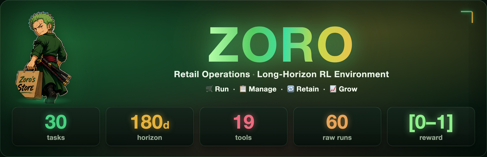
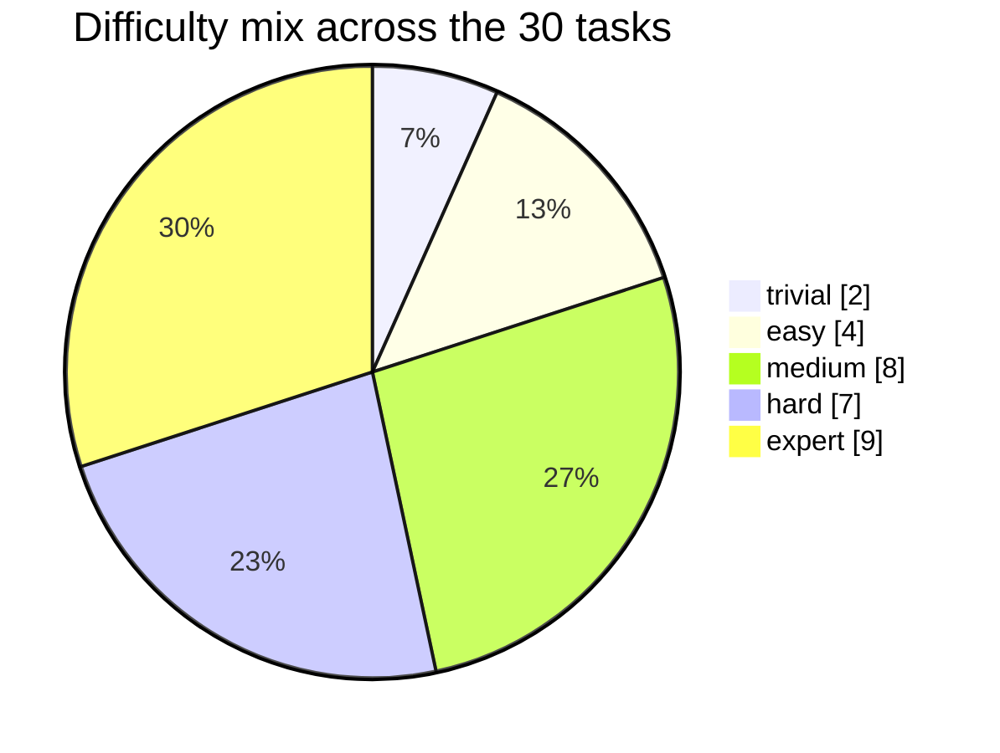
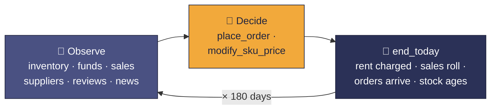
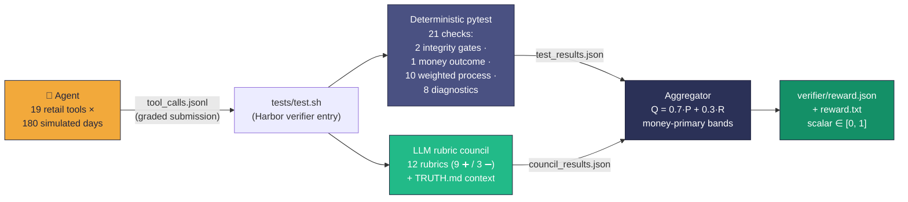
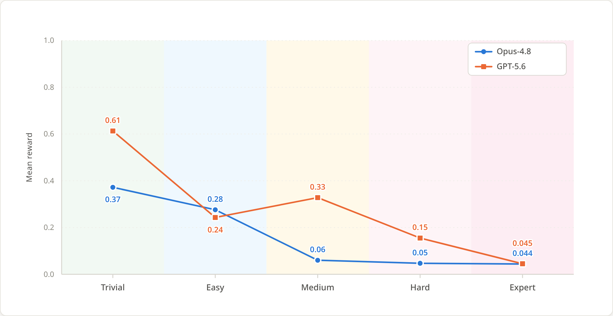

<div align="center">



# Zoro · Retail Operations RL Environment

**🛒 Run. &nbsp;📋 Manage. &nbsp;🔁 Retain. &nbsp;📈 Grow.**

> **Long-horizon agentic RL environment · 30 Harbor tasks · 180 simulated days per episode ·
> a 19-tool retail-store simulator graded by deterministic checks plus an LLM rubric council ·
> money-primary scalar reward in `[0, 1]`**

[Motivation](#-motivation--intended-use)&nbsp; · &nbsp;[Environment](#-inside-the-environment)&nbsp; · &nbsp;[Reward](#-reward-design)&nbsp; · &nbsp;[Grading](#-how-grading-works)&nbsp; · &nbsp;[Dataset](#-whats-in-this-delivery)&nbsp; · &nbsp;[Results](#-results-two-frontier-models-scored)


*The storefront creed on the chalkboard, **Run · Manage · Retain · Grow**, is the whole game: operate the store, day after day, and compound.*

</div>

Sample delivery of the **Zoro** RL environment: **30 [Harbor-format](https://github.com/harbor-framework/harbor) tasks**, each dropping an agent into a seeded, simulated retail store for **180 simulated days** with one objective, to **maximize terminal net worth**, defined as *cash + inventory at depreciated cost + in-transit order value*. The agent acts through 19 named tools (ordering, pricing, and a rich observation surface over sales, suppliers, reviews, returns, and news); its `tool_calls.jsonl` trace is the graded submission.

Every task ships with a full oracle solution, frozen scoring config, a judge-facing ground-truth narrative, and **scored agent trajectories from two frontier models** (`opus-4.8` and `gpt-5.6-sol`). This drop is graded: the verifier has been run on all 60 trajectories, and each run carries its `reward.json`, `reward.txt`, and the deterministic/council intermediates that produced it. Headline numbers are in [Results](#-results-two-frontier-models-scored).

## TL;DR

- **What it is.** A reinforcement-learning *environment*, not a static Q/A set. Each episode is a 180-day sequential-decision problem: daily ordering, shelf pricing, perishable stock, supplier quality driving return rates, cross-SKU cannibalization, and (on 8 tasks) daily news events that shift demand. The reward is a scalar in `[0, 1]` written through the standard Harbor verifier contract (`reward.json` + `reward.txt`).
- **How it grades.** A hybrid verifier: 21 deterministic pytest checks over the trajectory (money outcome + process hygiene + integrity gates), a 12-rubric **LLM council** that judges the agent's *stated strategy* against a per-task `TRUTH.md` ground-truth narrative, and an aggregator that combines them under a **money-primary** formula. Profitable runs score in `[0.55, 1.00]`, unprofitable runs in `[0.00, 0.45]`, so any profitable run outranks any unprofitable one by construction.
- **Why it discriminates.** Each task's ceiling is pinned by a real oracle run (per-task `oracle_nw`, e.g. `$94,245.37` on task `000632bd`), and the shipped frontier runs fall far short of it. Across all 30 tasks the mean scored reward is about **0.10 for `opus-4.8`** and **0.21 for `gpt-5.6-sol`**, against an attainable ceiling of 1.0. `opus-4.8` turns a profit on 2 of 30 tasks and `gpt-5.6-sol` on 6 of 30. The headroom is real.
- **What ships now.** 30 task directories (spec, world config, oracle solution, tests, truth file) plus **60 scored agent runs** (2 models × 30 tasks × 1 run) with full per-day step files, checkpoints, token usage, and the verifier output for each run.

## ✨ At a glance

| Field | Value |
| --- | --- |
| Environment | **Zoro**, a seeded retail-store simulator, operated day by day over a fixed horizon |
| Format | [Harbor](https://github.com/harbor-framework/harbor) tasks (on-host grading, no Docker image, by design) |
| Tasks | 30, all 180-day horizons |
| Objective | Maximize terminal net worth = cash + inventory at depreciated cost + in-transit value |
| Action/observation space | 19 named tools (3 actions, 14 observations, 2 note-taking) |
| Graded submission | The agent's `tool_calls.jsonl` trace (per `task.toml`) |
| Grading | `tests/test.sh` runs 21 deterministic pytest checks + 12-rubric LLM council + money-primary aggregator |
| Reward | Money-primary scalar ∈ `[0, 1]`; profit band `[0.55, 1.00]`, loss band `[0.00, 0.45]` |
| Verifier timeout | 1,800 s per task (council fan-out dominates) |
| Oracle solution | `solution/` in every task: `solve.sh`, full `tool_calls.jsonl`, `golden.json` with outcome + input hashes |
| Trajectories | 60 scored runs: `opus-4.8` + `gpt-5.6-sol`, one `run_1/` each per task, verifier output included |
| Large files | All `*.jsonl` tracked via Git LFS (`.gitattributes`) |
| License | MIT, © 2026 Ethara.AI |

## Table of contents

- [TL;DR](#tldr)
- [At a glance](#-at-a-glance)
- [Motivation & intended use](#-motivation--intended-use)
- [Inside the environment](#-inside-the-environment)
- [What's in this delivery](#-whats-in-this-delivery)
  - [Sample counts](#sample-counts)
  - [The 30-task matrix](#the-30-task-matrix)
  - [Full task inventory](#full-task-inventory)
- [Repository layout](#-repository-layout)
- [The agent's contract](#-the-agents-contract)
- [Reward design](#-reward-design)
- [How grading works](#-how-grading-works)
- [Results: two frontier models, scored](#-results-two-frontier-models-scored)
- [Quality posture](#-quality-posture)
- [`task.toml` quick reference](#-tasktoml-quick-reference)
- [Running the verifier](#-running-the-verifier)
- [Versioning, licensing & citation](#-versioning-licensing--citation)
- [Design notes](#-design-notes)

---

## 🎯 Motivation & intended use

**Why this exists.** Most agentic training tasks reward short bursts of competence: fix a bug, pass a suite, answer a question. Zoro targets the regime that actually separates policies, long-horizon sequential decision-making under uncertainty. Over 180 simulated days an agent has to manage cash flow against daily rent, order perishable stock ahead of demand, price against elastic and cross-cannibalizing categories, read supplier quality out of return rates and reviews, and (in the dynamic tasks) react to news-driven demand shocks. A single good decision means little; the reward measures the *compounded* quality of thousands of decisions, and mistakes such as stockouts, cash paralysis, and spoilage carry forward.

**Primary intended use.** A reinforcement-learning reward source for training long-horizon agentic models. The consumer rolls out their policy on each task and uses the verifier's scalar reward.

**Also suitable for.**

- **Offline capability read-outs** of economic reasoning, planning depth, and tool-use discipline over a genuinely long horizon.
- **Ablations** on scaffolds, memory strategies (the environment ships `add_note` / `view_notes`), and context management. The shipped trajectories include per-day checkpoints and token-usage records precisely to support this.
- **Curriculum construction**: the batch spans five difficulty grades and four economy sizes under one uniform contract.

**Out of scope / not designed for.**

- **A saturated leaderboard.** Both scored frontier models sit far below the oracle ceiling (see [Results](#-results-two-frontier-models-scored)); treat the numbers here as a starting baseline, not a solved benchmark.
- **Real-world retail fidelity beyond the simulator.** The world is a seeded simulation with configurable economics; claims should be made about policy quality within it, not about real store operations.

**Audience.** ML researchers and engineers training long-horizon agentic models, and authors extending the Zoro recipe to new worlds.

---

## 🏪 Inside the environment

Each task is a self-contained Harbor job around a seeded retail-world simulator. The contract a model faces, per task:

1. The agent receives `instruction.md` (~17 lines): run a retail store for 180 days from a fixed cash position, maximize terminal net worth, pay daily rent, manage a capacity-bounded warehouse of perishable stock across named product categories where supplier quality drives return rates. (The frozen world config pins `store_id = 15` on every task.)
2. Each simulated day, the agent reviews inventory, funds, sales, supplier prices, and review data through its observation tools, then places orders and sets shelf prices, and calls `end_today` to advance the clock.
3. The full tool-call trace, `tool_calls.jsonl`, is the submission: one JSON object per call with `{ts, tool, args, result, funds, net_worth, current_date, elapsed_time}`. The verifier grades that trace: deterministic checks compute the money outcome and process hygiene, and an LLM council judges the agent's stated strategy against the task's `TRUTH.md`.

The world is frozen per task in `environment/dataset.json`, a flat config (27 top-level keys) fixing the simulation window, store id, economics (`initial_funds`, `everyday_rent`, `inventory_capacity`, `review_ratio`), feature toggles (`enable_review`, `enable_new`), news parameters, the selected category list, per-category cannibalization coefficients, and both the global and news random seeds. An integrity gate in the test battery verifies the run actually used the frozen config.

---

## 📦 What's in this delivery

30 UUID-named task directories at the repository root, each a complete Harbor task. Every task ships:

| Deliverable | Where it lives |
| --- | --- |
| Agent-facing spec | `<task-uuid>/instruction.md` |
| Frozen world config | `<task-uuid>/environment/dataset.json` |
| Judge-facing ground truth | `<task-uuid>/TRUTH.md` (council context: setup, strong-operator play by phase, must-hold properties, failure modes) |
| Harbor metadata | `<task-uuid>/task.toml` |
| Verifier | `<task-uuid>/tests/` (`test.sh`, `test_outputs.py`, `rubrics.json`, `thresholds.json`) |
| Oracle solution | `<task-uuid>/solution/` (`solve.sh`, full `tool_calls.jsonl`, `golden.json`, `metadata.json`) |
| Scored model trajectories | `<task-uuid>/trajectories/{opus-4-8, gpt-5-6-sol}/run_1/` (agent run + `verifier/` output) |

### Sample counts

<div align="center">

| 🏷️ Archetype | Samples |
| --- | ---: |
| `still_middle`, static world, smaller portfolio | **7** |
| `still_hard`, static world, 20-category portfolio | **8** |
| `dynamic_middle`, smaller portfolio | **7** |
| `dynamic_hard`, 20 categories + live news events | **8** |
| **Total** | **30** |

| 🎚️ Difficulty | Samples |
| --- | ---: |
| trivial | **2** |
| easy | **4** |
| medium | **8** |
| hard | **7** |
| expert | **9** |
| **Total** | **30** |

| 💵 Economy tier | Samples |
| --- | ---: |
| micro ($5,000 start) | **8** |
| small ($10,000 start) | **6** |
| mid ($30,000 start) | **12** |
| large ($50,000 start) | **4** |
| **Total** | **30** |

| 🤖 Scored frontier-model runs | Runs | Trajectory directory |
| --- | ---: | --- |
| `opus-4.8` | **30** (1 per task) | `trajectories/opus-4-8/run_1/` |
| `gpt-5.6-sol` | **30** (1 per task) | `trajectories/gpt-5-6-sol/run_1/` |
| **Total** | **60** | verifier output under each `run_1/verifier/` |

</div>

Every sample additionally ships **1 oracle solution** (30 total) and **1 ground-truth narrative** (30 total); news dynamics are live on **8** samples (`enable_new = true`, exactly the `dynamic_hard` eight), customer reviews on all **30**.

### The 30-task matrix

The batch is a deliberate grid over three axes: **archetype** (static vs. news-driven world × portfolio complexity), **difficulty**, and **economy size**.

**Archetype × difficulty** (cell = task count):

| Archetype | trivial | easy | medium | hard | expert | **Total** |
| --- | ---: | ---: | ---: | ---: | ---: | ---: |
| `still_middle` | 1 | 2 | 3 | 1 | 0 | **7** |
| `still_hard` | 0 | 0 | 1 | 3 | 4 | **8** |
| `dynamic_middle` | 1 | 2 | 3 | 1 | 0 | **7** |
| `dynamic_hard` | 0 | 0 | 1 | 2 | 5 | **8** |
| **Total** | **2** | **4** | **8** | **7** | **9** | **30** |



**Economy tiers** (identical within tier across tasks):

| Tier | Tasks | Starting cash | Daily rent | Warehouse capacity | Categories |
| --- | ---: | ---: | ---: | ---: | ---: |
| micro | 8 | $5,000 | $120 | 6,000 units | 4 |
| small | 6 | $10,000 | $250 | 10,000 units | 5 |
| mid | 12 | $30,000 | $700 | 25,000 units | 20 |
| large | 4 | $50,000 | $1,000 | 40,000 units | 20 |

**Other axes.**

- **Cross-SKU cannibalization** (`category_effect`) sweeps from -0.2 to -0.4 across the set, so portfolio interaction strength is itself a difficulty dial. The hardest static task (`d6927ef5...`, `still_hard`/expert) runs κ = -0.4 across 20 categories with no news at all, while `f8ab5919...` (`dynamic_hard`/expert) stacks the same -0.4 on top of news shocks and new-product arrivals.
- **News dynamics** (`enable_new = true`): enabled on exactly the **8 `dynamic_hard` tasks**, where daily news can shift demand for products or whole categories and new products can appear mid-run; the other 22 tasks are static-world.
- **Customer reviews** (`enable_review = true`): on for **all 30 tasks**. Review signal and supplier-quality inference are part of every episode.
- **Horizon**: 180 days, uniform across all 30.

### Full task inventory

<details>
<summary><strong>Expand: all 30 tasks</strong> (UUID = directory name · κ = <code>category_effect</code> · News = <code>enable_new</code>)</summary>

| Task UUID | Archetype | Difficulty | Tier | Categories | κ | News |
| --- | --- | --- | --- | ---: | ---: | :---: |
| `c2789eb2-73ef-5ac5-9be8-fee09d29997f` | still_middle | trivial | micro | 4 | -0.25 | - |
| `69328851-1aa7-5b64-9b0a-686fb1cd1207` | still_middle | easy | micro | 4 | -0.30 | - |
| `cbd603c3-5115-5a8c-9b19-06eee19acc02` | still_middle | easy | micro | 4 | -0.35 | - |
| `11a94c69-4beb-5bc9-8cd0-68ecb4c660c9` | still_middle | medium | small | 5 | -0.25 | - |
| `614fe8a9-05ec-5fe4-9e42-e58032b9e045` | still_middle | medium | small | 5 | -0.20 | - |
| `626f0435-a919-5ee8-8e2a-82c886a789b6` | still_middle | medium | micro | 4 | -0.40 | - |
| `f62e57e0-657a-5f2e-a8ef-4fbfc13f7797` | still_middle | hard | small | 5 | -0.30 | - |
| `3feb7d26-cc07-54aa-9fba-1ef518298ecd` | still_hard | medium | mid | 20 | -0.225 | - |
| `000632bd-192b-5d23-8a13-b9af919b1542` | still_hard | hard | mid | 20 | -0.275 | - |
| `a140d799-d29d-5050-831a-00b06e0958a2` | still_hard | hard | mid | 20 | -0.30 | - |
| `f9b64d40-1277-546a-b1a6-567c3370c498` | still_hard | hard | mid | 20 | -0.25 | - |
| `091ef453-61c5-5796-8430-d937e060138f` | still_hard | expert | mid | 20 | -0.35 | - |
| `48e706d5-72f5-5b53-860f-25618297a128` | still_hard | expert | large | 20 | -0.20 | - |
| `730c53f1-be4c-5502-aa65-a5fd1b1918c0` | still_hard | expert | mid | 20 | -0.325 | - |
| `d6927ef5-5755-5bf8-bef6-6a65211a4fcc` | still_hard | expert | mid | 20 | -0.40 | - |
| `48df3c8b-f46f-50e6-983e-d583fda86fa2` | dynamic_middle | trivial | micro | 4 | -0.25 | - |
| `4091bea3-bab5-53fc-b81d-5bd6286cf1bf` | dynamic_middle | easy | micro | 4 | -0.35 | - |
| `70a4673a-d04f-5792-9761-de6a939a7139` | dynamic_middle | easy | micro | 4 | -0.30 | - |
| `657e8b9d-a8a5-58c4-94d2-b0f0636027dc` | dynamic_middle | medium | micro | 4 | -0.40 | - |
| `defa01ea-8403-5732-afe2-ad19a98302b4` | dynamic_middle | medium | small | 5 | -0.20 | - |
| `f2200047-d5b4-58fe-b9d0-6367297ecd7a` | dynamic_middle | medium | small | 5 | -0.25 | - |
| `700be30f-d840-5b26-aec0-5dfac431313b` | dynamic_middle | hard | small | 5 | -0.30 | - |
| `ed026cee-4d8e-5ebc-a13c-1d8d7ba8f0ee` | dynamic_hard | medium | mid | 20 | -0.20 | ✔ |
| `6b2a889c-3b73-5e69-9478-513b4863f21e` | dynamic_hard | hard | mid | 20 | -0.25 | ✔ |
| `891a0d2a-028a-5c17-ab92-8ba39f9bebb3` | dynamic_hard | hard | mid | 20 | -0.30 | ✔ |
| `66a86154-6950-5594-9786-0339ba0d4fd6` | dynamic_hard | expert | mid | 20 | -0.35 | ✔ |
| `68505b1a-e67f-5ad3-b5ba-071989370769` | dynamic_hard | expert | large | 20 | -0.20 | ✔ |
| `d0f8ad74-049d-5646-baf6-430dc680c4bb` | dynamic_hard | expert | large | 20 | -0.25 | ✔ |
| `e8fb4ba2-acf4-5169-a4cb-ab8789eb074c` | dynamic_hard | expert | large | 20 | -0.30 | ✔ |
| `f8ab5919-929c-53a1-a307-90cdfa1644a2` | dynamic_hard | expert | mid | 20 | -0.40 | ✔ |

</details>

---

## 📁 Repository layout

```
zoro-samples/
├── README.md
├── LICENSE                              # MIT, © 2026 Ethara.AI
├── banner.png                           # the ZORO hero banner at the top of this README
├── mascot.png                           # the Zoro's Store emblem (circular, transparent bg)
├── graph.png                            # mean reward by difficulty, opus-4.8 vs gpt-5.6-sol
├── .gitattributes                       # *.jsonl tracked via Git LFS
├── .gitignore
└── <task-uuid>/                         # × 30, UUID = task identity
    ├── task.toml                        # Harbor metadata (archetype, difficulty, ...)
    ├── instruction.md                   # the spec the agent sees (~17 lines)
    ├── TRUTH.md                         # judge/author-facing ground truth, fed to the council
    ├── environment/
    │   └── dataset.json                 # frozen world config (27 keys: economics, seeds, toggles, categories)
    ├── solution/
    │   ├── solve.sh                     # replays the oracle policy via the shared harness
    │   ├── tool_calls.jsonl             # full oracle trajectory (LFS; 90.4 MB / 23,931 lines on task 000632bd)
    │   ├── golden.json                  # oracle outcome + policy/data sha256 hashes
    │   └── metadata.json
    ├── tests/
    │   ├── test.sh                      # Harbor verifier entry point (41 lines)
    │   ├── test_outputs.py              # 21 deterministic checks over the trajectory
    │   ├── rubrics.json                 # 12 council rubrics (9 positive, 3 negative)
    │   └── thresholds.json              # frozen scoring formula, world params, oracle_nw, calibration
    └── trajectories/
        ├── opus-4-8/                    # model `opus-4.8`
        │   └── run_1/
        │       ├── agent/               # raw run context: tool_calls.jsonl, per-day strategy/execute
        │       │                        #   step files, per-day checkpoints, token usage, env dump
        │       └── verifier/            # scored output: reward.json, reward.txt,
        │                                #   test_results.json, council_results.json
        └── gpt-5-6-sol/                 # model `gpt-5.6-sol`
            └── run_1/                   # same shape (agent/ + verifier/)
```

> [!NOTE]
> **Cloning:** all `.jsonl` files (oracle solutions and agent traces) are stored via **Git LFS**. Clone with `git lfs` installed to materialize them.

---

## 🤝 The agent's contract

**The day loop.** Each simulated day the agent observes, decides, and advances: review inventory / funds / sales / supplier prices / reviews, place orders and set shelf prices, then `end_today`. Rent is charged daily; stock is perishable; supplier quality drives return rates; the warehouse is capacity-bounded.



**Action & observation space, 19 tools** (enumerated in each task's `test_outputs.py` as `VALID_TOOLS`):

| Group | Tools |
| --- | --- |
| Actions (3) | `place_order` · `modify_sku_price` · `end_today` |
| Observations (14) | `view_current_orders` · `view_sku_sales_history` · `view_current_date_supplier_prices` · `view_supplier_price_history` · `view_inventory` · `view_sku_reviews` · `view_sku_avg_ratings` · `view_return_rates` · `view_returns` · `view_funds_and_date` · `view_sku_prices` · `view_today_news` · `view_news_detail` · `view_news_history` |
| Memory (2) | `add_note` · `view_notes` |

**The submission.** Every call is logged as one JSON line, `{ts, tool, args, result, funds, net_worth, current_date, elapsed_time}`, and the resulting `tool_calls.jsonl` is the graded artifact declared in `task.toml`.

**Ground truth for judges.** Each task's `TRUTH.md` (10.9 KB / 92 lines on task `000632bd`) narrates the fixed setup, what a great run looks like phase-by-phase (opening days 1-10, steady state 11-160, endgame 161-180), **14 properties a good run must satisfy**, and **11 characteristic failure modes**. On task `000632bd` it anchors expectations concretely: the oracle closed at `$94,245`, and below about `$75,000` has fallen short. Scoring machinery lives in the tests; `TRUTH.md` is passed to the council via `--truth`.

---

## 🧮 Reward design

### Money-primary scoring, frozen per task in `tests/thresholds.json`

The reward answers one question first: *did the agent make money, and how much of the oracle's headroom did it capture?* Process and strategy quality act only as a small refinement.

Three signals are computed:

- **O, money outcome** ∈ `[0, 1]`: `O = clip((horizon_pinned_nw - initial_funds) / (oracle_nw - initial_funds), 0, 1)`, where *horizon pinning* charges rent for any unfinished days, so quitting early cannot dodge the cost of the remaining horizon. `oracle_nw` comes from the shipped oracle run (`solution/golden.json`).
- **P, process quality** ∈ `[0, 1]`: the weighted pass fraction of 10 deterministic process checks (weights sum 12.5; see [How grading works](#-how-grading-works)).
- **R, council score** ∈ `[0, 1]`: the LLM council's rubric score over the agent's *stated strategy text*.

These combine as `Q = 0.7·P + 0.3·R` (falling back to `Q = P` if the council is unavailable), then:

| Outcome | Formula | Band |
| --- | --- | --- |
| Made money | `score = 0.55 + 0.40·O + 0.05·Q` | `[0.55, 1.00]` |
| Lost money | `score = 0.40·clip(nw / initial_funds, 0, 1) + 0.05·Q` | `[0.00, 0.45]` |

> [!IMPORTANT]
> The **0.10 band gap guarantees any profitable run outranks any unprofitable one**: money is about 90% of rank, and process/strategy polish can never rescue a losing operation. Two integrity gates (weight 0, `ok | exclude`) sit outside the formula; excluded runs are reported separately and floored at 0.0 in means.

### Why this design

- **Dense and monotone.** `O` is continuous in captured oracle headroom, so the reward has gradient throughout training: not a pass/fail cliff at profitability, and no plateau once profitable.
- **Anti-gaming by construction.** The primary signal is the simulator's own economics; process checks catch trace-level pathologies (tool misuse, order droughts, cash paralysis); the council judges strategy text against a ground-truth narrative it alone sees. An agent cannot pattern-match the grader, it has to run a good store.
- **Oracle-calibrated, honestly.** `thresholds.json` carries an explicit `calibration` block: process thresholds were measured from a single oracle run, with marks set strictly below the oracle's observed rate so the oracle passes by construction (Gate 4a), and several process thresholds are flagged **provisional** pending broader calibration.

### The grading pipeline



---

## 🔬 How grading works

`tests/test.sh` (41 lines, byte-identical across all 30 tasks except the embedded `--task-id`) orchestrates three stages, reading the submission from `SUBMISSION` (an agent run dir or its `tool_calls.jsonl`) and writing to `VERIFIER_OUT` (default `$TASK_DIR/verifier`):

1. **Deterministic pytest** on `tests/test_outputs.py` (`--task-id/--traj-path/--dataset-path/--thresholds-path`, JSON out to `test_results.json`; run with `|| true` because test failures are data, not errors). The battery is **21 checks**, each tagged `@pytest.mark.check(id, weight, knockout, category, kind)`:
   - **2 integrity gates** (weight 0): the run's config matches the frozen task; the trajectory is readable with finite net worth.
   - **1 money-outcome check** computing `O` with horizon pinning.
   - **10 weighted process checks** (weights sum **12.5**): `valid_tools_used` 1.0 · `supplier_board_before_order` 1.5 · `view_orders_before_place` 1.0 · `day1_order_placed` 1.5 · `day1_supplier_read_before_order` 0.5 · `priced_before_first_sale` 1.0 · `reorder_after_stockout` 1.0 · `no_prolonged_order_drought` 1.5 · `no_cash_paralysis` 1.5 · `low_signal_drift_bounded` 2.0.
   - **8 zero-weight diagnostics** (days survived, growth multiple, near-peak, trailing drawdown, portfolio count, return rate, spoilage rate, margin inversion): reported, not scored.
2. **LLM council**: the shared council runner consumes `tests/rubrics.json` and the task's `TRUTH.md` (via `--rubrics` / `--truth`) and writes `council_results.json`. `rubrics.json` is exactly **12 rubrics** per task (`R1-R12`, task-specific wording): 9 positive (score 3 or 5) and 3 negative (score -3 or -5), spanning setup / pricing / supplier / reorder / strategy / stockout / portfolio / endgame, each graded `important` or `critically_important`. All rubrics judge the agent's **stated reasoning**, with `TRUTH.md` as the council's ground-truth context. The judge panel is shared config (`judges.yaml`) across all 30 tasks, not per-task. Skippable with `NO_COUNCIL=1` (then `Q = P`).
3. **Aggregation**: the shared aggregator combines `test_results.json` + `council_results.json` under `tests/thresholds.json` and writes the Harbor reward contract, `reward.json` and scalar `reward.txt`, into the `verifier/` directory.

`thresholds.json` (149 lines) freezes everything the formula needs: the task id, the scoring block, the world config (days, seed, category list), the per-task `oracle_nw`, outcome thresholds (`cash_idle = 60000`, `stall_frac = 0.02`), process thresholds (`T_supplier = 0.95`, `T_vieworders = 0.8`, `T_reorder = 0.4`, `R_lowsignal = 1.0`, `drought_len = 40`, `deploy_dollars_min = 2800`, `paralysis_deploy_dollars = 5600`, several flagged provisional), diagnostic bands, and the calibration provenance.

> [!NOTE]
> **On-host grading, by design.** `task.toml` carries no `docker_image` and no Dockerfile ships. Harbor's container engine is intentionally not used, and `allow_internet = true` exists solely so the verifier can reach the council's judge vendors. This convention is uniform across all 30 tasks.

---

## 📊 Results: two frontier models, scored

Every trajectory in this drop has been run through the verifier. Each `run_1/verifier/` holds the scalar `reward.txt`, the full `reward.json` (with `O`, `P`, `R`, `Q`, band, and pinned net worth), plus the `test_results.json` and `council_results.json` behind it. The chart below is the mean reward per difficulty grade for each model, computed directly from those 60 `reward.txt` files.

<div align="center">



</div>

**Mean reward by difficulty**

| Difficulty | Tasks | `opus-4.8` | `gpt-5.6-sol` |
| --- | ---: | ---: | ---: |
| trivial | 2 | 0.37 | 0.61 |
| easy | 4 | 0.28 | 0.24 |
| medium | 8 | 0.06 | 0.33 |
| hard | 7 | 0.05 | 0.15 |
| expert | 9 | 0.044 | 0.045 |
| **All 30** | 30 | **~0.10** | **~0.21** |

What the numbers say:

- **Both models are far from the ceiling.** `O = 1.0` is demonstrated attainable on every task by its oracle, yet the mean scored reward is about 0.10 for `opus-4.8` and 0.21 for `gpt-5.6-sol`. There is roughly a full band of headroom left above the frontier.
- **Profitability is rare.** A run only clears 0.55 if it ends in the black. `opus-4.8` does that on 2 of 30 tasks, `gpt-5.6-sol` on 6 of 30. Everything else lands in the loss band, and most expert runs sit at the `~0.04-0.05` floor, meaning capital was essentially wiped out.
- **Neither model dominates.** `gpt-5.6-sol` leads at trivial, medium, and hard, but `opus-4.8` edges it at easy (0.28 vs 0.24), and the two converge at the expert floor. The lines cross, which is exactly the discrimination the money-primary reward is built to expose.
- **Reward decays with difficulty, as intended.** Both curves fall from the trivial/easy grades into a near-floor at hard and expert. The environment is unsaturated where it matters most, and the per-day strategy files and checkpoints under each `agent/` directory show where and why policies unravel.

For a concrete example, on task `000632bd` (still_hard / hard / mid tier, oracle net worth `$94,245.37`) the `opus-4.8` run ended in the loss band with net worth about `-$1,044` and a score of `0.05`, while the `gpt-5.6-sol` run scored `0.046`. Both ran out of runway well before day 180.

---

## ✅ Quality posture

- **Every task has a full oracle solution.** `solution/solve.sh` replays a parameterized oracle policy (`sample_size = 2`, `bulk_qty_multiplier = 4` on task `000632bd`) via the shared harness; `golden.json` records the outcome (task `000632bd`: `final_net_worth = 94,245.37`, `days_completed = 180/180`, `survival_fraction = 1.0`, `oracle_version = v1`) plus a `policy_source_sha256` and `external_data_sha256` hashes over its 5 data inputs, so the oracle run is fingerprinted end to end. That oracle trace is 23,931 tool calls (90.4 MB) produced in 518.87 s.
- **Attainable, per-task ceiling.** The oracle's `oracle_nw` is the denominator of the money score, so `O = 1.0` is demonstrated-attainable on every task, and the ceiling scales with the economy (a micro-tier task has a far smaller ceiling than a mid- or large-tier one).
- **Uniform structure, verified.** Spot-checked across tasks: identical directory layout; `tests/test.sh` byte-identical modulo the `--task-id` line; `dataset.json` has the identical 27-key set everywhere; `test_outputs.py` is per-task generated but structurally the same battery (same check ids and weights, cosmetic differences only); `rubrics.json` is always 12 rubrics on one schema with task-specific wording. What varies is exactly what should: world economics, seeds, category lists, `oracle_nw`, and the prose that tracks them.
- **Integrity gates before scoring.** A run graded against the wrong world config, or an unreadable / non-finite trajectory, is excluded (`integrity_gate: exclude`) rather than silently scored. All 60 shipped runs pass the gate (`integrity: ok` in each `reward.json`).
- **Honest calibration provenance.** Threshold marks are declared as single-oracle-run measurements with provisional flags in `thresholds.json`, so the delivery documents its own calibration maturity instead of overstating it.

**Disclosed conventions** (stated plainly rather than papered over):

- The `dynamic_middle` archetype name is historical: those 7 tasks ship `enable_new = false` and their instructions contain no daily-news mechanic, so behaviorally they are static-world. The news mechanic is live exactly on the 8 `dynamic_hard` tasks.
- `instruction.md` / `description` wording varies slightly across tasks ("Operate" vs "Operating", plain prose vs bold-emphasized numbers); the contract content is equivalent.
- `solution/metadata.json` and trajectory `config.json` / `args.json` retain absolute paths from the authoring machines (inert, never read at grade time); a stray `tests/__pycache__/*.pyc` is present in some tasks.
- The shared scoring package (council runner + aggregator), the council's `judges.yaml`, and the oracle harness (`tools/run_oracle.py`) referenced by `test.sh` / `solve.sh` are shared components **external to this repo**.

---

## 📄 `task.toml` quick reference

Each task carries a compact Harbor metadata file. Task `000632bd`, abridged for readability and annotated:

```toml
version = "1.0"

[metadata]
archetype    = "still_hard"            # still_middle | still_hard | dynamic_middle | dynamic_hard
difficulty   = "hard"                  # trivial | easy | medium | hard | expert
horizon_days = 180
world_config = "environment/dataset.json"   # frozen world; integrity-gated at grade time
submission   = "tool_calls.jsonl"           # the graded artifact
oracle_policy = { sample_size = 2, bulk_qty_multiplier = 4 }   # knobs behind solution/solve.sh
# ... per-task provenance fields elided: id, suite, description, economic_tier,
#   category_count, category_effect, enable_new, enable_review

[environment]
# Grading is on-host: no Dockerfile ships and docker_image is intentionally
# omitted, so Harbor's container engine is not used here. Internet is allowed
# only so the verifier can reach the council's judge vendors.
allow_internet = true

[verifier]
timeout_sec = 1800.0                   # council fan-out dominates the budget
```

What varies across the 30 tasks: `archetype`, `difficulty`, the world economics and seeds inside `dataset.json`, the category lists, the rubric wording, and each `thresholds.json`'s frozen config / `oracle_nw`. The envelope (layout, tool surface, check battery, scoring formula, timeout) is invariant.

---

## 🔁 Running the verifier

`tests/test.sh` is the single per-task entry point, driven by environment variables. The scored outputs already shipped in this drop were produced this way:

```bash
cd <task-uuid>

# SUBMISSION: an agent run dir (e.g. trajectories/opus-4-8/run_1/agent)
#             or a tool_calls.jsonl directly.
# VERIFIER_OUT: output dir (default: $TASK_DIR/verifier).
SUBMISSION=trajectories/opus-4-8/run_1/agent \
VERIFIER_OUT=trajectories/opus-4-8/run_1/verifier \
bash tests/test.sh
```

Outputs land in `VERIFIER_OUT`: `test_results.json`, `council_results.json`, and the Harbor reward contract `reward.json` + `reward.txt`. To re-grade a run yourself, point `VERIFIER_OUT` at a scratch directory and compare.

> [!TIP]
> **Deterministic-only mode:** set `NO_COUNCIL=1` to skip the LLM council entirely. `Q` falls back to `P` and grading needs no external judge access.

> [!WARNING]
> The verifier imports the shared scoring package (council runner, aggregator, judge panel config), and the oracle replay uses the shared harness's `tools/run_oracle.py`. These components are not vendored into this sample repo. The complete, runnable grading stack accompanies the full delivery; this sample ships every *per-task* grading artifact (checks, rubrics, thresholds, truth files) plus the verifier output for all 60 runs.

---

## 📜 Versioning, licensing & citation

**Versioning.** This is the **Zoro sample delivery**: 30 tasks generated from one parameterized recipe over archetype × difficulty × economy-tier × cannibalization settings. Task identity is the UUID directory name; task content is fingerprinted by the sha256 hashes recorded in each `solution/golden.json` (`policy_source_sha256` plus `external_data_sha256` over the oracle's 5 data inputs). There is no semantic version tag on the delivery itself; cite it by the repository state you received plus the per-task hashes.

**Licensing.** This repository ships under the **MIT License** (see `LICENSE` at the root, copyright © 2026 Ethara.AI). The MIT grant covers the contents of this repository: task specs, world configs, truth files, tests, oracle artifacts, and trajectories. The shared components referenced but not included (the scoring package, council judge configuration, and oracle harness) are governed by their own terms and are not covered by this repository's license.

**Citation.** When reporting results computed against this delivery, identify (a) the task set (*Zoro sample delivery, 30 tasks*), (b) the exact task content (UUID + `golden.json` hashes), (c) the grading configuration (each task's `thresholds.json`, and whether the council ran or `NO_COUNCIL=1` was used), and (d) the model and scaffold rolled out against it.

---

## 🧭 Design notes

1. **Why a hybrid grader.** Deterministic checks alone can verify *what happened* in a 180-day trace (money made, tools used legally, no droughts or paralysis) but not *whether the strategy was sound for the right reasons*. The council covers that gap: 12 rubrics judged against a per-task `TRUTH.md` that encodes phase-by-phase strong play, 14 must-hold properties, and 11 failure modes. The split is asymmetric on purpose: the deterministic money outcome carries about 90% of rank, and the council's share is capped inside the 0.05·Q term, so LLM judgment refines but never decides.
2. **Why money-primary with a band gap.** In a trading-style environment, process elegance without profit is failure. The disjoint bands (`[0.55, 1.00]` vs `[0.00, 0.45]`) make the reward's ordering semantics legible to both a training loop and a human reviewer: profitability is a hard ranking boundary, captured-headroom (`O`) is the dense signal above it, and capital preservation is the dense signal below it. Horizon pinning closes the quit-early loophole by charging rent for unplayed days, which is why the loss-band runs in [Results](#-results-two-frontier-models-scored) score so low.
3. **Why on-host grading.** The environment's grading needs (a council fan-out to external judge vendors, a 1,800 s verifier budget dominated by that fan-out, and pure trace analysis with no code execution from the submission) fit on-host verification better than Harbor's container path. `task.toml` documents the choice explicitly rather than leaving an empty `docker_image` to look like an omission.
4. **Scaling the recipe.** The per-task footprint (`instruction.md` + `environment/dataset.json` + `tests/` + `solution/` + `TRUTH.md` + `task.toml`) is uniform across all 30 tasks and generated from a single parameterized recipe: new tasks are new points in the archetype × difficulty × tier × κ × seed grid, with the oracle harness producing the per-task ceiling and calibration marks. The same envelope extends to longer horizons, larger category sets, and richer event dynamics without touching the grader contract.

---

<div align="center">


**Zoro · Retail Operations RL Environment**
🛒 Run. &nbsp;📋 Manage. &nbsp;🔁 Retain. &nbsp;📈 Grow.

Sample delivery · 30 tasks · 60 scored runs · MIT © 2026 Ethara.AI

✦ &nbsp;·&nbsp; ✦ &nbsp;·&nbsp; ✦

</div>
